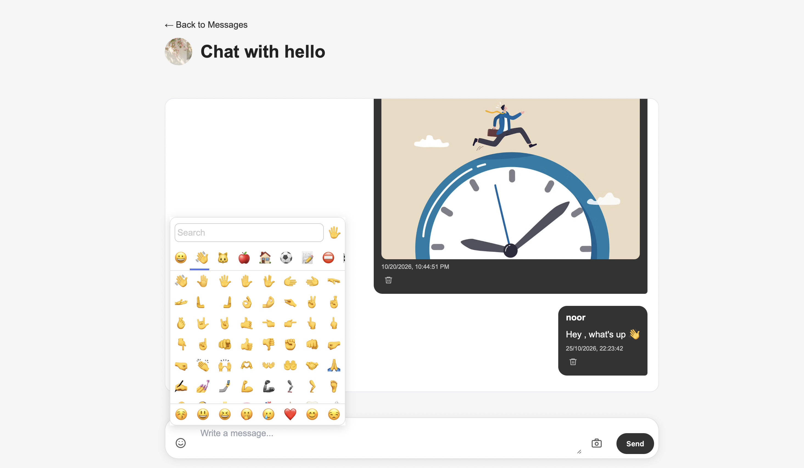
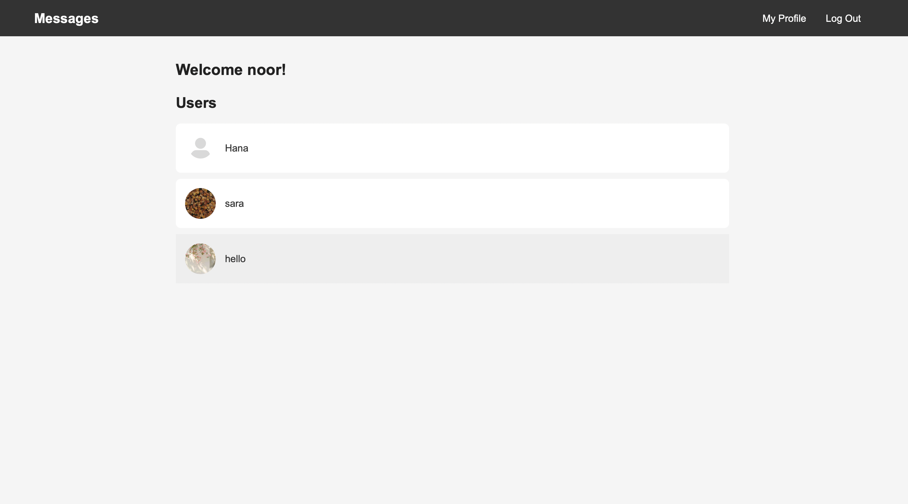
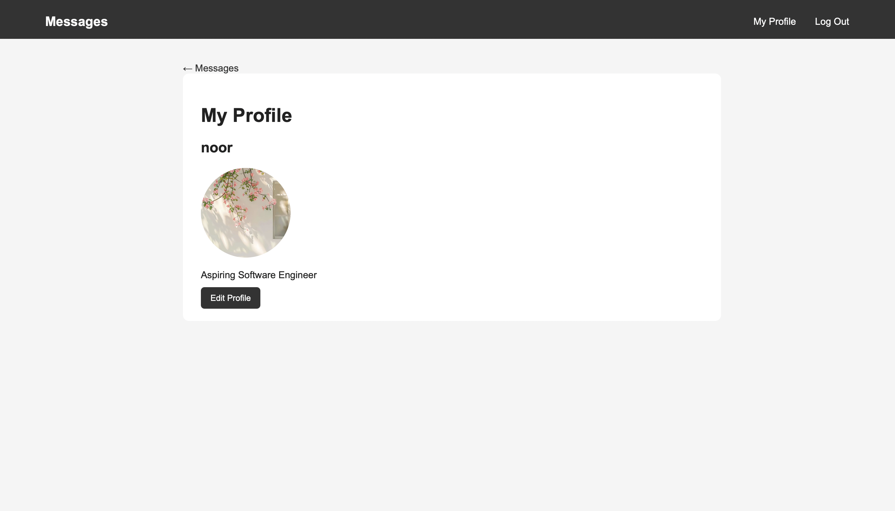
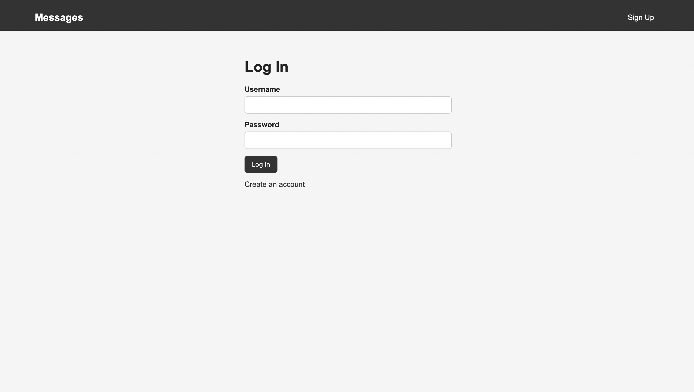

# Message App

A full-stack messaging application built with Node.js, Express.js, PostgreSQL, and EJS. Users can create accounts, customize their profiles, and communicate through private conversations with text and image messages.

## Features

- **User Authentication:** Register and log in securely using Passport.js and bcrypt password hashing.
- **Private Messaging:** Start conversations with other registered users.
- **Text and Image Messages:** Send text messages, images, or both in a single message.
- **Emoji Support:** Include emojis in conversations.
- **User Profiles:** View profiles and customize your bio and profile picture.
- **Session Management:** Maintain authenticated sessions using Express Session.
- **Persistent Storage:** Store user accounts, profiles, and messages in PostgreSQL using Prisma ORM.

## Screenshots

### Conversation Page



### Messages Page



### User Profile



### Login Page



## Tech Stack

| Technology | Purpose |
|---|---|
| Node.js | JavaScript runtime |
| Express.js | Backend web framework |
| PostgreSQL | Relational database |
| Prisma ORM | Database access and migrations |
| EJS | Server-rendered views |
| Passport.js | User authentication |
| bcrypt | Password hashing |
| Multer | Image uploads |
| HTML & CSS | User interface |

## Project Structure

```text
Message-App/
├── controllers/       # Request handling and application logic
├── middleware/        # Authentication and upload middleware
├── prisma/
│   ├── migrations/    # Database migration history
│   └── schema.prisma  # Database models
├── public/
│   ├── css/           # Stylesheets
│   ├── images/        # Static images
│   └── js/            # Client-side JavaScript
├── routes/            # Application routes
├── views/             # EJS templates
├── app.js             # Application entry point
├── db.js              # Prisma database client
├── passportconfig.js  # Passport configuration
├── package.json
└── README.md
```

## Getting Started

### Prerequisites

- [Node.js](https://nodejs.org/)
- [PostgreSQL](https://www.postgresql.org/)
- npm

### 1. Clone the repository

```bash
git clone https://github.com/Noorelsobky/Message-App.git
cd Message-App
```

### 2. Install dependencies

```bash
npm install
```

### 3. Configure environment variables

Create a `.env` file in the project root. Add the environment variables required by your application.

For example:

```env
DATABASE_URL="your_postgresql_connection_string"
SESSION_SECRET="your_session_secret"
```

Replace these placeholders with your actual values. Never commit your `.env` file or expose credentials publicly.

### 4. Set up the database

Create a PostgreSQL database and configure `DATABASE_URL` in your `.env` file.

Apply the existing Prisma migrations:

```bash
npx prisma migrate deploy
```

Generate the Prisma Client:

```bash
npx prisma generate
```

### 5. Run the application

```bash
npm start
```

Open the local URL and port configured in `app.js` in your browser.

## Database Models

- **User:** Stores account information, a hashed password, profile bio, and profile picture path.
- **Message:** Stores message content, an optional image path, creation timestamp, sender, and receiver.

## Security

- Passwords are hashed using bcrypt.
- Passport.js handles authentication.
- Environment variables are used for configuration and secrets.
- Production deployments should use HTTPS and secure session-cookie settings.

## Future Improvements

- Deploy the application with a production database.
- Add real-time messaging and notifications.
- Implement message deletion.
- Use persistent or cloud-based storage for uploaded images.
- Add automated tests.

## Author

**Noor Elsobky**

[GitHub Profile](https://github.com/Noorelsobky)

---

Built to practice backend development, authentication, relational database design, file uploads, and server-rendered web applications.
